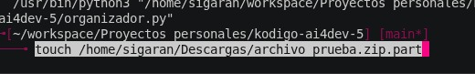

# Organizador Automático de Descargas 
**Estudiante:** Anthony Manuel Sigarán Orellana  
**Proyecto:** Script de automatización y gestión de archivos con `systemd` y `gio`  

## 2. Evidencia de Vibecoding (Prompts Utilizados)

### a. Prompts iniciales

1. >`#Eres un experto programador en python`**

2. >`#Haremos un script que lea las extensiones de los archivos en una carpeta (como .pdf, .mp3, .jpg) y los mueva automaticamente a subcarpetas ordenadas. Consideraciones: Os debian 13. Directorio: /home/sigaran/Descargas. Archivos diferentes no tomar en cuenta.`**

3. >`#Me parece, pero creo que con esto puede mejorar. Haremos lo siguiente: Automatizaremos el proceso con un servicio de systemd, con un temporizador para una ejecucion periodica manual. Ademas, los archivos temporales (part, .crdownload, .tmp) se moveran a papeleria (utilizar gio subprocess.run).`**

---

### b. Breve explicación
i. **Qué se pidió a la IA**: Se solicitó un script para organizar archivos en `~/Descargas` por extensión, y posteriormente, automatizar dicha tarea mediante un servicio y temporizador de `systemd`, integrando la gestión de archivos temporales mediante `gio trash`.

ii. **Por qué se ajustó o refinó el prompt**: Se refinó para incluir requerimientos de automatización a nivel de sistema operativo (`systemd`) y mejores prácticas de gestión de residuos (`gio trash`) en lugar de simplemente eliminar archivos, mejorando la robustez y utilidad del script original.

---

## 3. Iteración y Mejora

### Modificación Solicitada a la I
Se ajustó la lógica original (que únicamente clasificaba y movía archivos estáticos) para incorporar la detección y manejo inteligente de extensiones temporales de descargas activas (`.part`, `.crdownload`, `.tmp`).

### Evidencia Visual

*Prueba de la segunda modificación creando un archivo temporal:*  

---

## 4. Validación del Resultado
a. **Pruebas del código**:   Se verificó la lógica realizando ejecuciones de prueba directas y simulando la creación manual de archivos de prueba (`.tmp`, `.part`, `.pdf`, `.mp3`) dentro de `/home/sigaran/Descargas`. Se validó la correcta sintaxis de `pathlib`, el funcionamiento del comando `gio trash` vía `subprocess` y el correcto disparo del temporizador en `systemd`.

b. **Identificación de error/ajuste**:  
  * **Problema:** En el planteamiento inicial, crear una carpeta física llamada `/Papelera` y mover los archivos ahí resultaba poco robusto y no permitía su restitución estándar en el entorno gráfico.
  * **Ajuste:** Se corrigió la instrucción para invocar la herramienta de escritorio de Gnome/FreeDesktop mediante `subprocess.run(['gio', 'trash', archivo])`, integrando los archivos temporales a la papelera nativa de Debian 13.

---

## 5. Reflexión Final

 El desarrollo asistido por IA permite escalar rápidamente ideas simples (un script de ordenamiento) hacia soluciones robustas e integradas con el sistema operativo (`systemd` + `gio`) en una fracción del tiempo habitual.

* **b. Ventajas y Límites del Vibecoding:**  
  * **Ventajas:** Alta velocidad para prototipar, generar boilerplate de configuración (archivos `.service` y `.timer`) y estructurar la sintaxis de librerías del sistema (`pathlib`, `subprocess`).
  * **Límites:** Requiere supervisión técnica constante por parte del desarrollador para garantizar que los permisos, rutas absolutas de Linux y comandos del sistema (`gio`) se ejecuten de forma segura sin comprometer la integridad de la información del usuario.

* **c. Comprensión del Código:**  
  * **Comprendido con claridad:** La manipulación de rutas con `pathlib.Path`, el filtrado por extensiones y la ejecución de comandos del sistema operativo mediante `subprocess`.
  * **A reforzar:** La parametrización avanzada de unidades de servicio en `systemd` (manejo de variables de entorno de usuario `systemctl --user` y directivas de seguridad).

---

*Antes*

*Despues*

